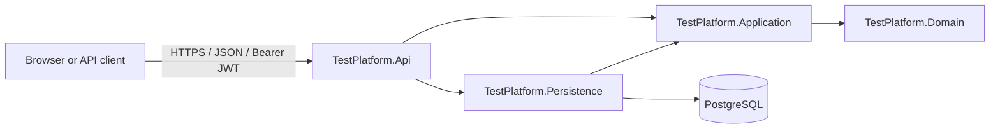

# System Overview

## Components

`TestPlatform.Api` is the composition root. It maps minimal API endpoints, configures JWT bearer authentication, authorization policies, CORS, OpenAPI, and dependency injection. It depends on Application and Persistence.

`TestPlatform.Application` owns use cases. Each write operation is a MediatR command with a FluentValidation validator and handler. Queries and result DTOs live beside their feature.

`TestPlatform.Domain` owns aggregate behavior and invariants without framework or database references. It contains `User`, `RefreshToken`, `Question`, `Test`, and `TestAttempt` behavior.

`TestPlatform.Persistence` implements Application repository interfaces with EF Core and PostgreSQL. It owns mappings, migrations, seeding, and database initialization.

## Request Flow

1. A request reaches a minimal API endpoint in `TestPlatform.Api/Endpoints`.
2. JWT bearer validation checks signature, issuer, audience, expiry, session ID, and user token version.
3. An endpoint policy checks permission claims. Content mutations then pass the authenticated actor into an Application command.
4. The command validator checks request shape; its handler loads aggregates through repository interfaces and applies domain behavior.
5. The persistence implementation saves changes through `TestPlatformDbContext`.
6. The endpoint maps validation, authorization, not-found, and business errors to HTTP responses.

## Data Ownership

| Data | Owner | Notes |
| --- | --- | --- |
| User | `User` entity | Profile, password hash, one role, token version. |
| Refresh token | `RefreshToken` entity | Opaque token hash, stable session ID, expiry, revocation state. |
| Question | `Question` aggregate | Options, correct option, explanation, soft-delete flag, creator. |
| Test | `Test` aggregate | Title, ordered question references, creator. |
| Submission | `TestAttempt` aggregate | Authenticated submitter, selected answers, evaluation result. |

## Architectural Decisions

- The system uses JWT access tokens plus opaque, persisted refresh tokens rather than cookie sessions.
- Roles are stored as a single validated value; permissions are emitted into JWT claims.
- Session validation is intentionally database-backed on authenticated requests so logout is immediate.
- Content ownership is enforced in Application handlers, not only by API route policy.
- Existing decisions are recorded in [authentication ADR](../adr/0001-adopt-jwt-bearer-authentication.md).
